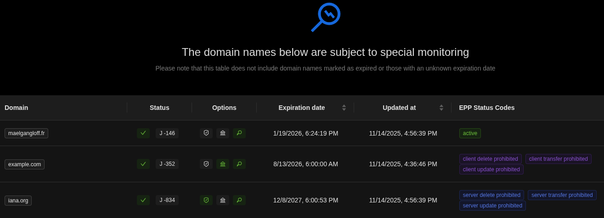

import {LinkCard} from '@astrojs/starlight/components';

The tracking table is a single view of **every domain name present in your Watchlists**, without duplicates. Domains are
sorted by their estimated deletion date, so the domain names closest to becoming available again always appear first.

## What does the tracking table show?

| Column           | Content                                                                                                                       |
|------------------|-------------------------------------------------------------------------------------------------------------------------------|
| Domain           | The tracked domain name                                                                                                       |
| Status           | The lifecycle phase of the domain and, when it can be estimated, the number of days before it is removed from WHOIS (`J -12`) |
| Options          | Three indicators, green when enabled: Registry Lock, Registrar Lock and DNSSEC                                                |
| Expiration date  | The current expiration date published by the registry (sortable)                                                              |
| Updated at       | The last time Domain Watchdog refreshed the domain through RDAP (sortable)                                                    |
| EPP Status Codes | The raw EPP status codes of the domain, with an explanation on hover (filterable)                                             |

By default, only domain names still present in WHOIS are displayed. Use the filter of the **Status** column to also show
domain names that have already been deleted.

## How to read the Status column?

The Status column summarizes the [domain lifecycle](/en/definitions/domain-lifecycle/) phase with a single icon:

- **Active**: the domain is registered and has no deletion-related status.
- **Auto-Renew Grace Period**: the domain has expired and the registrar can still renew it.
- **Redemption Grace Period**: the domain has been deleted by the registrar; the former registrant can still restore it.
- **Pending Delete**: the domain will be purged from the registry database within a few days.
- **Removed from WHOIS**: the domain no longer exists in the registry and may be available for registration.

The `J -N` counter is colored in **red** when deletion is expected within 5 days and in **orange** within 35 days. An
exclamation mark means that the deletion is imminent.

When at least one tracked domain is in redemption period or pending deletion, a warning banner is displayed at the top
of the table.

## How is the deletion date estimated?

RDAP does not publish the date on which a domain will be released. Domain Watchdog estimates it from the events and
statuses collected for each domain:

- from the **expiration date**, by adding the usual durations of the auto-renew grace period (45 days), the redemption
  period (30 days) and the pending delete period (5 days);
- from the **deletion event**, if the registry has published one, by adding the redemption period;
- from the **current EPP status codes** of the domain.

The estimate is indicative: registries and registrars apply their own policies, and a domain may be renewed or restored
at any time before it is purged.

<LinkCard title="Watchlist" description="Choose the domain names that appear in the tracking table" href="/en/features/tracking/watchlist/"/>
<LinkCard title="Domain lifecycle" description="Understand each phase from registration to deletion" href="/en/definitions/domain-lifecycle/"/>
