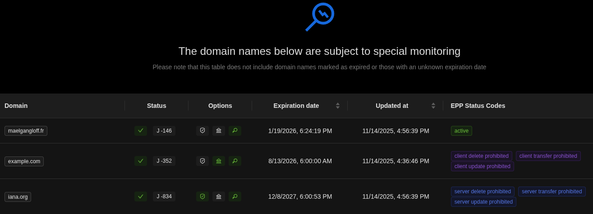

import {LinkCard} from '@astrojs/starlight/components';

Le tableau de suivi rassemble en une seule vue **tous les noms de domaine présents dans vos Watchlists**, sans doublon.
Les domaines sont triés selon leur date de suppression estimée : les noms de domaine les plus proches de redevenir
disponibles apparaissent toujours en premier.

## Que contient le tableau de suivi ?

| Colonne             | Contenu                                                                                                                                 |
|---------------------|-----------------------------------------------------------------------------------------------------------------------------------------|
| Domaine             | Le nom de domaine suivi                                                                                                                 |
| Statut              | La phase du cycle de vie du domaine et, lorsqu'elle peut être estimée, le nombre de jours avant sa suppression du WHOIS (`J -12`)       |
| Options             | Trois indicateurs, en vert lorsqu'ils sont actifs : Registry Lock, Registrar Lock et DNSSEC                                             |
| Date d'expiration   | La date d'expiration actuellement publiée par le registre (triable)                                                                     |
| Mis à jour le       | La dernière actualisation du domaine par Domain Watchdog via RDAP (triable)                                                             |
| Codes de statut EPP | Les codes de statut EPP bruts du domaine, avec une explication au survol (filtrable)                                                    |

Par défaut, seuls les noms de domaine encore présents dans le WHOIS sont affichés. Utilisez le filtre de la colonne
**Statut** pour afficher également les noms de domaine déjà retirés du WHOIS.

## Comment lire la colonne Statut ?

La colonne Statut résume la phase du [cycle de vie du domaine](/fr/definitions/domain-lifecycle/) avec une icône :

- **Actif** : le domaine est enregistré et ne présente aucun statut lié à une suppression.
- **Période de grâce** (renouvellement automatique) : le domaine a expiré et le bureau d'enregistrement peut encore le renouveler.
- **Période de rédemption** : le domaine a été supprimé par le bureau d'enregistrement ; l'ancien titulaire peut encore le restaurer.
- **En attente de suppression** : le domaine sera purgé de la base du registre d'ici quelques jours.
- **Retiré du WHOIS** : le domaine n'existe plus dans le registre et peut être disponible à l'enregistrement.

Le compteur `J -N` s'affiche en **rouge** lorsque la suppression est attendue sous 5 jours et en **orange** sous 35 jours.
Un point d'exclamation signale une suppression imminente.

Lorsqu'au moins un domaine suivi est en période de rédemption ou en attente de suppression, un bandeau d'avertissement
s'affiche en haut du tableau.

## Comment la date de suppression est-elle estimée ?

RDAP ne publie pas la date à laquelle un domaine sera libéré. Domain Watchdog l'estime à partir des événements et des
statuts collectés pour chaque domaine :

- à partir de la **date d'expiration**, en ajoutant les durées usuelles de la période de grâce de renouvellement
  automatique (45 jours), de la période de rédemption (30 jours) et de l'attente de suppression (5 jours) ;
- à partir de l'**événement de suppression**, s'il a été publié par le registre, en ajoutant la période de rédemption ;
- à partir des **codes de statut EPP** actuels du domaine.

Cette estimation est indicative : registres et bureaux d'enregistrement appliquent leurs propres règles, et un domaine
peut être renouvelé ou restauré à tout moment avant sa purge.

<LinkCard title="Watchlist" description="Choisissez les noms de domaine affichés dans le tableau de suivi" href="/fr/features/tracking/watchlist/"/>
<LinkCard title="Cycle de vie d'un domaine" description="Comprendre chaque phase, de l'enregistrement à la suppression" href="/fr/definitions/domain-lifecycle/"/>
